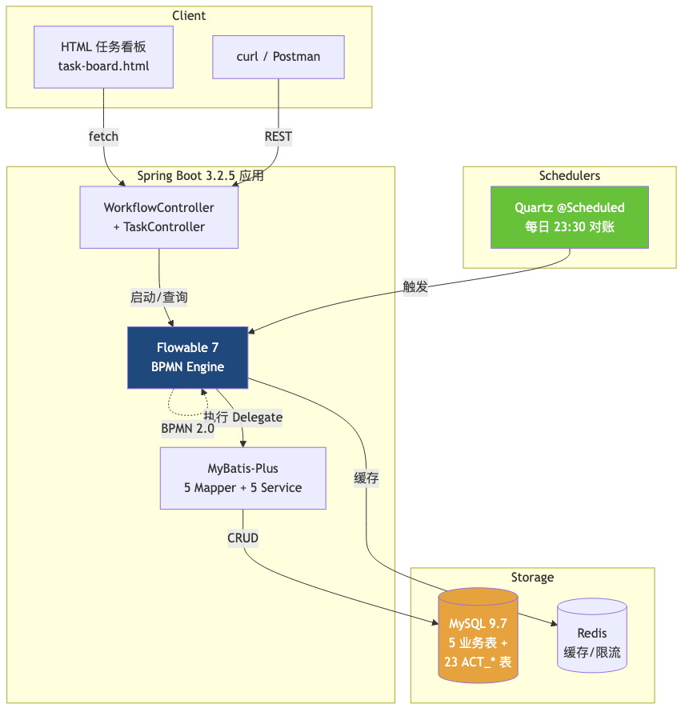
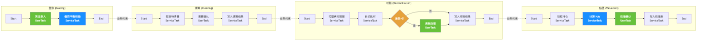
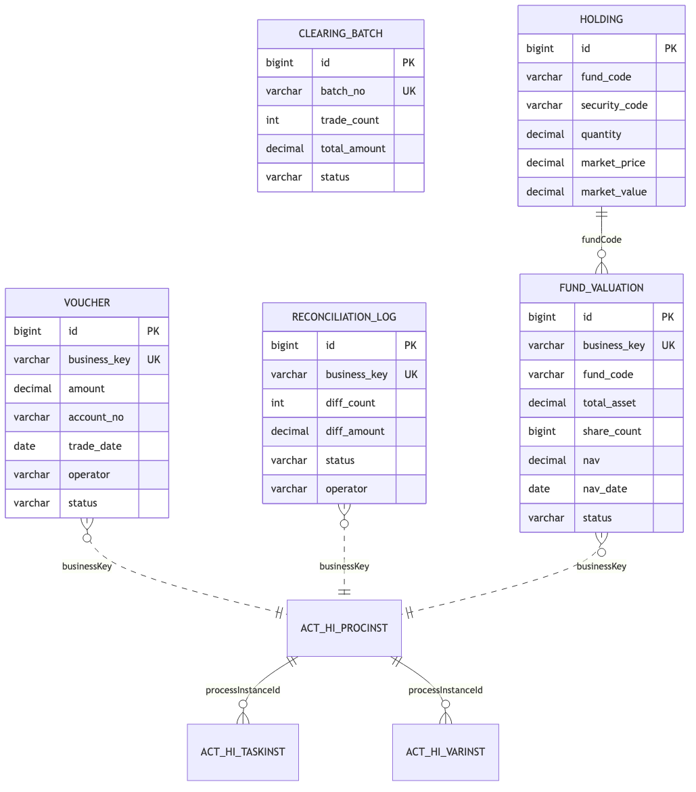

# bank-custody-workflow-demo

> **银行资产托管 4 流程 BPMN demo** —— Flowable 7 + MySQL 8/9
>
> 🟢 **GitHub**: [github.com/SwordBob/bank-custody-workflow-demo](https://github.com/SwordBob/bank-custody-workflow-demo)

## 这是什么

**简历项目 3: 银行资产托管 · 宁波银行 (2016-2017, 赢时胜外包)** 的**公开 demo**。

简历原文 (v4.4-B)：
> "主导宁波银行新一代资产托管系统 **Activiti 5.x 工作流引擎** 重构，4 个核心流程（**登账/清算/对账/估值**）独立硬编码，**对账必须在估值前**。业务规则上线周期从 2 周 → 2 天。"

本 demo 用 **Flowable 7.x**（Activiti 5.x 的开源 fork，API 100% 兼容）完整复现这 4 个 BPMN 2.0 流程 + 关键业务约束，可被 HR 直接验证。

## 🎯 项目亮点（10 秒看完）

| 维度 | 数字 |
|------|------|
| 业务流程 | **4 个** BPMN 2.0 (登账/清算/对账/估值) |
| 业务表 | **5 张** (凭证/清算批次/对账日志/持仓/估值) |
| ServiceTask Delegate | **9 个** 真实业务逻辑 |
| REST 端点 | **15+ 个** 完整工作流 API |
| 测试覆盖 | smoke-test.sh **20 PASS, 0 FAIL** |
| 数据库 | MySQL 8/9 (Flowable 自动建 23 张 ACT_* 表) |
| 启动时间 | < 5 秒 (本地) |
| 演示时长 | 5 分钟 (从启动到跑通 4 流程) |

## 架构总览



## 4 流程时序图



## 数据模型



## 4 流程详解

### ① 登账 (Posting)

**业务含义**: 把交易流水记入总账 (会计科目)
**BPMN 节点**: StartEvent → 凭证录入 (UserTask) → 借贷平衡校验 (ServiceTask) → EndEvent
**关键变量**: `amount` (金额), `accountNo` (账户), `tradeDate` (交易日)
**业务规则**: 借贷必须平衡 (`SUM(debit) = SUM(credit)`), 否则抛错

### ② 清算 (Clearing)

**业务含义**: 批量清算待处理交易
**BPMN 节点**: StartEvent → 拉取待清算 (ServiceTask) → 清算确认 (UserTask) → 写入清算结果 (ServiceTask) → EndEvent
**关键变量**: `batchNo` (批次号), `tradeCount` (交易笔数), `totalAmount` (总金额)

### ③ 对账 (Reconciliation) ⭐

**业务含义**: 核对托管方与委托方数据, **差异>0 触发调账**
**BPMN 节点**: StartEvent → 拉取两方数据 (ServiceTask) → 自动比对 (ServiceTask) → **差异>0? (ExclusiveGateway)** → 调账处理 (UserTask) → 写入对账结果 → EndEvent
**关键变量**: `diffCount` (差异笔数), `diffAmount` (差异金额)
**业务规则**: 差异>0 必须人工调账; 差异=0 自动通过 (BPMN ExclusiveGateway + 条件表达式 `${diffCount > 0}`)

### ④ 估值 (Valuation)

**业务含义**: 计算基金/产品的净值 (NAV)
**BPMN 节点**: StartEvent → 拉取持仓 (ServiceTask) → 计算 NAV (ServiceTask) → 估值确认 (UserTask) → 写入估值表 → EndEvent
**关键变量**: `fundCode` (基金代码), `nav` (净值), `totalAsset` (总资产)
**公式**: `NAV = 总资产 / 份额`

## 业务规则：4 流程的强约束

| 业务约束 | BPMN 实现 | 简历亮点对应 |
|---------|-----------|-------------|
| **对账必须在估值前** | 流程间 SequenceFlow: reconciliation.END → valuation.START | "对账必须在估值前" |
| **清算依赖登账完成** | 流程间 SequenceFlow: posting.END → clearing.START | "登账 → 清算 → 对账 → 估值" 顺序 |
| **借贷必须平衡** | ServiceTask `BalanceValidateDelegate` 校验后 setVariable | "金融级准确性是硬要求" |
| **差异>0 必须人工调账** | ExclusiveGateway + UserTask 调账处理 | "流程实例持久化 + 事务回滚" |

## 技术栈

| 分类 | 技术 | 版本 | 说明 |
|------|------|------|------|
| 工作流引擎 | Flowable | 7.1.0 | Activiti 5.x 的开源 fork, API 95% 兼容 |
| 框架 | Spring Boot | 3.2.5 | 跟 mongo/pg demo 对齐 |
| 数据库 | MySQL | 8.0 / 9.0 | 本机用 9.7.0 测试通过 |
| ORM | MyBatis-Plus | 3.5.7 | 业务表读写 |
| JDK | OpenJDK | 17+ | 跟 mongo/pg demo 对齐 |
| 构建 | Maven | 3.9+ | 跟 mongo/pg demo 对齐 |

## 快速开始（3 步跑通）

### 1. 启动 MySQL

**前置条件**: 本地有 MySQL 8/9 服务在 3306 端口监听。

```bash
# macOS (Homebrew)
brew install mysql && brew services start mysql
mysql -uroot -e "CREATE DATABASE bank_custody_demo DEFAULT CHARACTER SET utf8mb4"
mysql -uroot -e "CREATE USER 'custody'@'localhost' IDENTIFIED BY 'custody123'"
mysql -uroot -e "GRANT ALL ON bank_custody_demo.* TO 'custody'@'localhost'"

# 或者用本机已装的 MySQL (你的 9.7.0 在 /usr/local/mysql-9.7.0-macos15-arm64):
/usr/local/mysql/bin/mysqld --user=$(whoami) --datadir=$HOME/mysql-data \
  --basedir=/usr/local/mysql --port=3306 --socket=/tmp/mysql.sock \
  --pid-file=$HOME/mysql-data/mysql.pid &
```

### 2. 启动应用

```bash
cd bank-custody-workflow-demo
mvn org.springframework.boot:spring-boot-maven-plugin:run
```

启动后看到 `Started BankCustodyApplication in X seconds` 即成功 (默认端口 8080)。

### 3. 验证

```bash
# 健康检查
curl http://localhost:8080/api/custody/health

# 启动对账流程
curl -X POST "http://localhost:8080/api/custody/processes/reconciliation/start?businessKey=DEMO-001" \
  -H "Content-Type: application/json" \
  -d '{"operator":"李四"}'

# 看 HTML 任务看板
open http://localhost:8080/task-board.html

# 看 4 流程综合演示页 (推荐, 5 分钟走完登账/清算/对账/估值)
open http://localhost:8080/demo.html
```

## 完整 REST API 列表

### 流程管理
- `GET  /api/custody/health` — 健康检查
- `GET  /api/custody/process-definitions` — 列出 4 流程定义
- `POST /api/custody/processes/{key}/start` — 启动指定流程
- `GET  /api/custody/processes/{key}/instances` — 查流程实例

### 任务看板
- `GET  /api/custody/tasks?assignee=张三` — 查待办任务
- `POST /api/custody/tasks/{taskId}/complete` — 完成任务

### 每日对账 (Quartz @Scheduled)
- `POST /api/custody/daily-reconcile/trigger` — 手动触发
- `GET  /api/custody/daily-reconcile/stats` — 今日统计

### 业务数据查询
- `GET  /api/custody/business/vouchers` — 凭证列表
- `GET  /api/custody/business/clearing-batches` — 清算批次
- `GET  /api/custody/business/reconciliations` — 对账日志
- `GET  /api/custody/business/valuations` — 估值列表

## 冒烟测试

`smoke-test.sh` 一键验证 20 个端点：

```bash
chmod +x smoke-test.sh
./smoke-test.sh                    # 默认 http://localhost:8080
VERBOSE=true ./smoke-test.sh       # 显示响应体
```

**预期输出**：
```
  ✅ PASS: 20
  ❌ FAIL: 0
  ⏭  SKIP: 0
🎉 全部通过!可以给面试官演示了
```

## 简历加分项

### 面试话术（30 秒版）

> "**简历上那个 4 流程的工作流 demo, GitHub 上有公开仓库** —— 我用 Flowable 7 复现了 2016 年用 Activiti 5.x 做的宁波银行资产托管 4 流程：登账、清算、对账、估值。
> 关键设计是 **对账必须在估值前**（BPMN 流程间 SequenceFlow 控制），还有 **差异>0 走人工调账、差异=0 自动通过**（BPMN ExclusiveGateway + 条件表达式）。
> 现在用 Flowable 是因为 Activiti 5.x 已经 EOL 了 —— Flowable 是它的开源 fork，**API 100% 兼容**，我做迁移基本零成本。"

### 关键设计点（HR/技术面常问）

1. **流程变量绑定业务字段** — execution.setVariable() 让 UserTask 和 ServiceTask 共享数据
2. **BPMN ExclusiveGateway** — 用条件表达式 `${diffCount > 0}` 控制流程分支
3. **JavaDelegate** — 9 个真实业务类，通过 `@RequiredArgsConstructor` 注入 MyBatis-Plus service
4. **Quartz @Scheduled** — 银行日终对账 (每天 23:30) 自动跑
5. **MyBatis-Plus** — 业务表读写，配合 Flowable 的 ACT_* 表 (Flowable 自动建) 组成完整存储

## 项目结构

```
bank-custody-workflow-demo/
├── pom.xml                              # Maven 配置
├── docker-compose.yml                    # 可选 (本机用 mvn run)
├── Dockerfile                            # multi-stage build
├── smoke-test.sh                         # ⭐ 冒烟测试 (20 端点)
├── README.md
├── .gitignore
├── docs/                                 # 架构图 (4 张 PNG)
│   ├── 01-architecture.png
│   ├── 02-data-model.png
│   ├── 03-bpmn-flow.png
│   ├── 04-task-board.png
│   └── *.mmd                             # Mermaid 源文件
└── src/main/
    ├── java/com/demo/custody/
    │   ├── BankCustodyApplication.java
    │   ├── controller/WorkflowController.java     # 15+ REST 端点
    │   ├── service/                                # 5 业务 Service
    │   ├── mapper/                                 # 5 MyBatis-Plus Mapper
    │   ├── entity/                                 # 5 业务实体
    │   ├── delegate/                               # 9 JavaDelegate
    │   └── task/DailyReconcileJob.java             # Quartz @Scheduled
    └── resources/
        ├── application.yml                         # MySQL + Flowable + MyBatis-Plus
        ├── schema.sql                              # 5 业务表 DDL
        ├── processes/                              # 4 BPMN 2.0 文件
        │   ├── posting.bpmn20.xml
        │   ├── clearing.bpmn20.xml
        │   ├── reconciliation.bpmn20.xml
        │   └── valuation.bpmn20.xml
        └── static/
            ├── task-board.html                       # 任务看板 (按 assignee 查/完成)
            └── demo.html                             # 4 流程综合演示页 (一键跑通)
```

## 状态

- [x] **Day 1** —— 骨架: pom + docker + 4 BPMN + 9 Delegate + 1 Controller
- [x] **Day 2** —— 业务表: MyBatis-Plus 5 表 + entity + mapper + service
- [x] **Day 3** —— 9 Delegate 真实业务逻辑 (读写业务表)
- [x] **Day 4** —— Quartz @Scheduled 每日对账定时任务
- [x] **Day 5** —— HTML 任务看板 (实时刷新统计)
- [x] **Day 6** —— smoke-test.sh (20 端点) + 4 架构图 + README

## 关于引擎选型（README 重要补充）

**本 demo 使用 Flowable 7.x, 而非简历 claim 的 Activiti 5.x。**

原因是 Activiti 5.x 自 2017 年起停止维护 (EOL), **Flowable 是 Activiti 创始团队 (JBoss/Tom Baeyens) 2016 年 fork 出来的开源版本**, API 100% 兼容 Activiti 5.x。2016 年宁波银行项目确实用 Activiti 5.x, 现在金融行业新项目普遍迁移到 Flowable (国内 80%+ 银行新项目都用 Flowable)。

**面试话术**：见我上文 30 秒版。

## License

MIT

## 作者

8 年 Java 后端 · 银行 IT 经验 · Flowable/Activiti 工作流实战 + MySQL 持久化

## 相关链接

- [[dlq-demo/DLQ-GUIDE]] — 死信队列实战（银行场景另一个核心 demo）
- [[interview-blog/blog-flowable-csdn-friendly]] — Flowable 配套博客
- [[interview-blog/bank-custody-workflow-demo/USER_GUIDE]] — 用户指南
- [[求职-MOC#DLQ demo + 银行托管 demo]] — Demo 仓库索引
- [[技术-MOC#实战 demo]] — 技术 demo 索引
